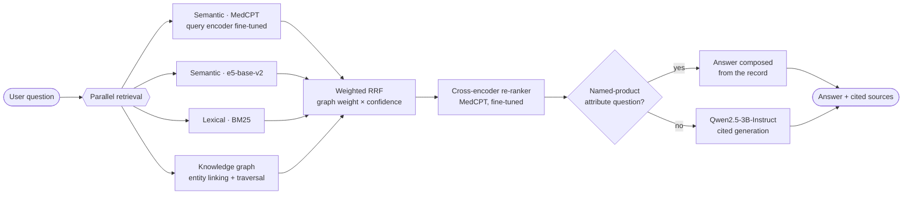

# MIRx

### A Parallelized Tribrid Retrieval-Augmented System for Medicine Information

MIRx answers questions about medicines — asked by brand name, by ingredient, or in plain language — from a
catalogue of **248,218 Indian brand-name medicine records**, and cites the record behind every statement.

It searches three kinds of source in parallel: **semantic** (fine-tuned MedCPT plus e5), **lexical** (BM25) and a
**knowledge graph** built from the records' own structured fields. Their rankings are fused with
confidence-weighted reciprocal-rank fusion and re-ranked by a fine-tuned cross-encoder. Questions about a named
product's attributes are answered directly from its record; everything else goes to an open-weight LLM
(Qwen2.5-3B-Instruct) that may only use the retrieved sources.

> **Not medical advice.** MIRx returns information from its indexed records. Consult a qualified clinician before
> making any treatment decision.

---

## Highlights

| | |
|---|---|
| **Retrieval quality** | NDCG@10 **0.865** [95% CI 0.841, 0.888] on a 378-query held-out test set |
| **Graph contribution** | +0.043 NDCG@10 over the best pipeline without the graph (p<sub>Holm</sub> < 0.001) |
| **Candidate recall** | 92.3% of relevant records reach the re-ranker, against 73.7% without the graph |
| **Answer accuracy** | Exact match on all 180 known-item test questions; citation precision 0.959 |
| **Speed** | ~0.2 s retrieval + re-ranking per query on a laptop GPU; parallel retrievers ×1.2–1.3 faster |

Every configuration was selected on development data only; the test split was scored once per configuration.

---

## Table of contents

1. [Architecture](#architecture)
2. [Data and benchmark](#data-and-benchmark)
3. [Results](#results)
4. [Repository layout](#repository-layout)
5. [Getting started](#getting-started)
6. [API](#api)
7. [Deployment](#deployment)
8. [Reproducibility](#reproducibility)
9. [Limitations](#limitations)
10. [Ethical considerations](#ethical-considerations)
11. [Citation](#citation)

---

## Architecture



### Components

| Stage | Method | Notes |
|---|---|---|
| **Semantic (1)** | `ncbi/MedCPT` article encoder for documents, query encoder fine-tuned on 15,201 training queries | CLS pooling, 768-d, inner product, exact search |
| **Semantic (2)** | `intfloat/e5-base-v2` | Mean pooling, cosine, exact search |
| **Lexical** | BM25 (k1 = 1.5, b = 0.75) | English stop words removed |
| **Knowledge graph** | Built from the records' structured fields: 406,270 product and brand-family nodes, 2,897 concept nodes, 3.88 M edges | Queries linked to products and concepts (e5 linker, threshold 0.80); traversal depth 200 |
| **Fusion** | Weighted reciprocal-rank fusion (k = 60), 100 candidates per retriever | Graph weight scaled by link confidence, so an unlinked query falls back to the other sources |
| **Re-ranking** | `ncbi/MedCPT-Cross-Encoder`, fine-tuned (lr 2e-5) | Top 100 re-scored; rank interpolation with fusion (α = 0.25 when the graph links, 1.0 otherwise) |
| **Answering** | Record fast path, else Qwen2.5-3B-Instruct (greedy, ≤ 300 new tokens, 6k-token context) | Every statement cites a source marker such as `[S1]`; the model abstains when sources are insufficient |

**Why three sources?** They fail differently. The graph is precise when it can link the query and silent when it
cannot; dense retrieval carries lay-language and generic-name questions; lexical retrieval anchors exact brand
strings. Confidence-weighted fusion lets the graph abstain without dragging results toward a wrong entity.

**Why exact dense search?** In Qdrant, every HNSW setting tested (ef 64–1024, int8 or float32) lost
significant NDCG@10 against exhaustive search (−0.023 even at ef = 1024), which we attribute to unnormalised
inner-product search over a strongly hub-dominated embedding space. Exhaustive search reproduces the evaluated
system exactly and costs ~32 ms per query at this corpus size.

---

## Data and benchmark

**Corpus.** *250k Medicines: Usage, Side Effects and Substitutes* (Kaggle). Each record has a product name and
seven fields: substitutes, side effects, uses, chemical class, therapeutic class, action class and habit forming.
Each record is indexed as one document, rendered as natural text without its substitute list (this alone raised
zero-shot MedCPT NDCG@10 from 0.274 to 0.497).

**Benchmark.** No public relevance judgments exist for this corpus, so we built one. Relevance is graded 0–3 by
deterministic rules over the record fields, without consulting any retrieval system; lay-language and
generic-name queries were written and labelled by hand.

| Category | Query types | Test | Dev | Train |
|---|---|---:|---:|---:|
| Known item | single fact, multi fact, side effects, alternatives | 180 | 118 | 15,201 |
| Attribute (rule-labelled) | attribute search, multi-condition | 135 | 92 | (shared) |
| Lay paraphrase (hand-labelled) | lay paraphrase | 30 | 25† | — |
| Generic name (hand-labelled) | fact, side effects, dosage, alternatives, comparative | 33 | 22† | — |
| **Total** | | **378** | **257** | **15,201** |

† Hand-written dev file, used for selection only. Splits are entity-disjoint: a brand, condition or class in a
test query appears in no other split, and training queries use paraphrased templates that never occur in dev or
test.

> The dataset is not redistributed in this repository. Download it from Kaggle and place it under `data/raw/`.

---

## Results

All numbers are on the held-out **test** split. Intervals are 95% bootstrap CIs (10,000 resamples);
significance uses two-sided paired randomisation tests with Holm correction.

### Retrieval (NDCG@10)

| System (each selected on dev) | All (378) | Rule-labelled (315) | Hand-labelled (63) |
|---|---:|---:|---:|
| Dense + BM25, off-the-shelf re-ranker | 0.744 | 0.770 | 0.615 |
| Dense + BM25, fine-tuned re-ranker | 0.812 | 0.862 | 0.564 |
| Dense + e5 + BM25, fine-tuned re-ranker (no graph) | 0.823 | 0.861 | 0.632 |
| Tribrid, first version | 0.850 | 0.902 | 0.591 |
| **MIRx (tribrid, final)** | **0.865** | **0.904** | **0.671** |

The largest gains are on multi-condition attribute queries (0.829 → 0.967), alternatives (0.550 → 0.754) and
comparative generic-name questions (0.484 → 0.751). Known-item fact queries stay at ≈ 0.92.

### Dense retrieval study (dense only)

| Configuration | NDCG@10 |
|---|---:|
| MedCPT, raw record text, cosine | 0.274 |
| MedCPT, natural text without substitutes, inner product | 0.497 |
| e5-base-v2, zero-shot | 0.668 |
| **MedCPT, query encoder fine-tuned** (mean of 5 seeds, sd 0.003) | **0.691** |

int8 quantisation was lossless (Δ = +0.0002) at a quarter of the memory; binary codes with float rescoring lost
only 0.001 at 1/32.

### Answer quality

| Metric | Queries | MIRx |
|---|---:|---:|
| Known-item exact match | 180 | **1.000** |
| Known-item token F1 | 180 | 0.805 |
| Attribute product precision | 161 | 0.931 |
| Citation precision | 357 citing | **0.959** |
| Invalid citations | 378 | 0.000 |
| Abstention rate | 378 | 0.013 |
| Answered from the record | 378 | 47.9% |
| Latency, median / mean | 378 | 8.9 s / 13.6 s |

Known-item questions follow templates the record fast path recognises, so their exact match is an upper bound,
not an estimate for free-form phrasing (see [Limitations](#limitations)).

### Latency (laptop RTX 5070, 8 GB)

| Stage | Sequential (median) | Parallel (median) |
|---|---:|---:|
| Retrieval stage (all four retrievers) | 32.0 ms | **27.0 ms** |
| Fusion + re-ranking | 163.7 ms | 174.6 ms |

End to end, generation dominates: retrieval and re-ranking are 1.9% of total time, and record-composed answers
take about 0.3 s.

---

## Repository layout

```text
MIRx/
├── mirx_service/            # Production pipeline and web service
│   ├── pipeline.py          #   retrievers, graph, fusion, re-ranking, fast path, generation
│   ├── app.py               #   FastAPI app: /api/ask, /health, web UI
│   └── static/index.html    #   single-page UI
├── deploy/huggingface/      # Docker image for a Hugging Face Space
├── artifacts/*.json         # Selected configurations (embedding, pipeline, production)
├── notebooks/               # Research notebooks (embeddings, retrieval, Qdrant, generation, evaluation)
├── requirements.txt
└── README.md
```

Large artifacts (embeddings, metadata, fine-tuned models, vector-store data) and the dataset are not kept in Git.
They are hosted in a separate artifacts repository and downloaded at start-up.

---

## Getting started

**Requirements:** Python 3.10+, ~16 GB RAM, and an NVIDIA GPU with ≥ 8 GB VRAM for interactive generation
(CPU works but generation is slow).

```bash
git clone https://github.com/JambavanAbhiram/Project-MIRx.git
cd Project-MIRx
python -m venv mirx-env
# Windows: mirx-env\Scripts\activate    Linux/macOS: source mirx-env/bin/activate
pip install -r requirements.txt
```

Place the artifacts under `artifacts/` (the paths are listed in `artifacts/mirx_production_config.json`), then
start the service from the project root:

```bash
python -m uvicorn mirx_service.app:app --host 0.0.0.0 --port 8000
```

Loading every model takes one to two minutes; `GET /health` reports `ready` once it is done. Open
<http://localhost:8000> for the web UI.

| Variable | Purpose |
|---|---|
| `MIRX_ROOT` | Project root containing `artifacts/` (auto-detected if unset) |
| `MIRX_ARTIFACTS_REPO` | Hugging Face repository the deployment downloads artifacts from |
| `HF_TOKEN` | Read token for that repository (keep it in an environment variable, never in code) |

---

## API

### `POST /api/ask`

```json
{ "query": "What are the side effects of Dolo 650 Tablet?" }
```

Response:

```json
{
  "query": "What are the side effects of Dolo 650 Tablet?",
  "answer": "Dolo 650 Tablet's side effects are ... [S1]",
  "mode": "extractive",
  "sources": [
    { "rank": 1, "document_id": "...", "name": "Dolo 650 Tablet", "text": "..." }
  ],
  "timings_ms": { "retrieval": 27.0, "fusion + rerank": 174.6, "generation": 0.0, "end-to-end": 201.6 },
  "disclaimer": "MIRx returns drug information from its indexed records. It is not medical advice; ..."
}
```

`mode` is `extractive` when the answer was composed from the record and `generated` when the LLM wrote it.
Queries must be 3–500 characters. The endpoint returns `503` while models are loading.

### `GET /health`

Returns `{"status": "ready" | "loading", "pipeline": ..., "generation": ...}`.

---

## Deployment

The service needs several gigabytes of artifacts and five models in memory, so serverless platforms
(Vercel, Streamlit Community Cloud, free-tier Render) cannot run it. The supported target is a **Hugging Face
Space** (Docker SDK, GPU recommended):

1. Upload the production artifacts to a private Hugging Face model repository.
2. Create a Docker Space from `deploy/huggingface/` (Dockerfile, `boot.py`, pinned `requirements.txt`).
3. Set the Space secret `HF_TOKEN` and the variable `MIRX_ARTIFACTS_REPO`.

On start-up, `boot.py` downloads the artifacts and serves the app on port 7860.

---

## Reproducibility

- Every design choice (document format, encoder, fine-tuning hyper-parameters, fusion weights, pool sizes,
  linking thresholds, interpolation, prompt, answer mode) was made on dev data. The selection score for the final
  pipeline is the mean NDCG@10 over the rule-labelled dev split and the hand-written dev file.
- Ablation steps are cumulative; a step is kept only if it beats the last kept step by more than 0.001, with ties
  broken toward the configuration least reliant on the graph.
- Test was scored once per configuration and never used for selection. Split files were hash-checked after the
  hand-written dev file was added.
- The selected configurations, with their dev and test scores, are recorded in `artifacts/*.json`.

---

## Limitations

- **Programmatic labels.** Most relevance labels come from rules over the same fields the graph is built from, so
  graph gains on those queries are an upper bound. The 63 hand-labelled test queries are the cleaner test; there,
  the gain over the best non-graph pipeline (+0.039) is not significant.
- **Templated questions.** Known-item questions follow templates, which favours lexical matching and the record
  fast path. Coverage of real user phrasing is unmeasured.
- **Single catalogue.** Indian brand-name products only, with no composition, dosage or interaction fields.
- **LLM-judge validity.** Prometheus 2 (7B) grades were stable but misjudged verbatim record answers as
  unfaithful, and have not been validated against clinicians; judge scores are reported only as upper bounds.

---

## Ethical considerations

MIRx provides catalogue information, not medical advice. Answers are restricted to retrieved records, cite their
sources, and the interface tells users to consult a clinician. Errors in the catalogue propagate to answers, and
the system has not been evaluated with patients or clinicians.

---

## Citation

If you use MIRx, please cite:

```bibtex
@software{mirx2026,
  title  = {MIRx: A Parallelized Tribrid Medical Information Retrieval System},
  author = {JambavanAbhiram},
  year   = {2026},
  url    = {https://github.com/JambavanAbhiram/Project-MIRx}
}
```

## Acknowledgements

MIRx builds on [MedCPT](https://github.com/ncbi/MedCPT) (NCBI), [e5](https://huggingface.co/intfloat/e5-base-v2),
[Qwen2.5](https://huggingface.co/Qwen/Qwen2.5-3B-Instruct), [Qdrant](https://qdrant.tech) and
[Prometheus 2](https://github.com/prometheus-eval/prometheus-eval).

## License

No license has been chosen yet; all rights are reserved until one is added.
